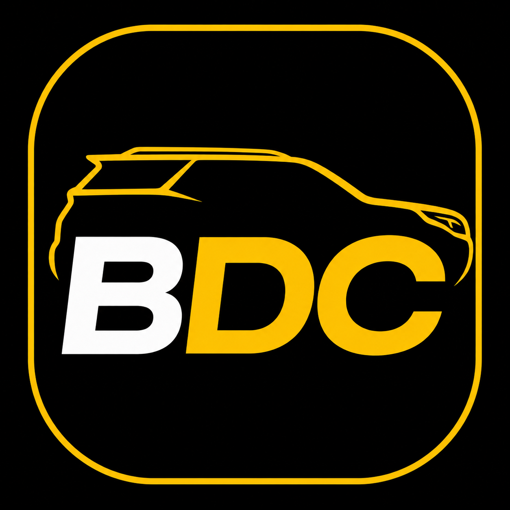
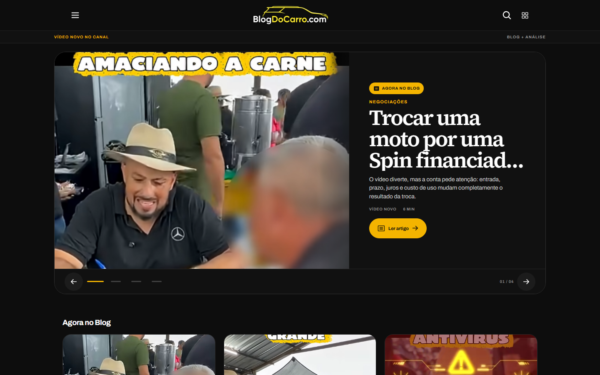
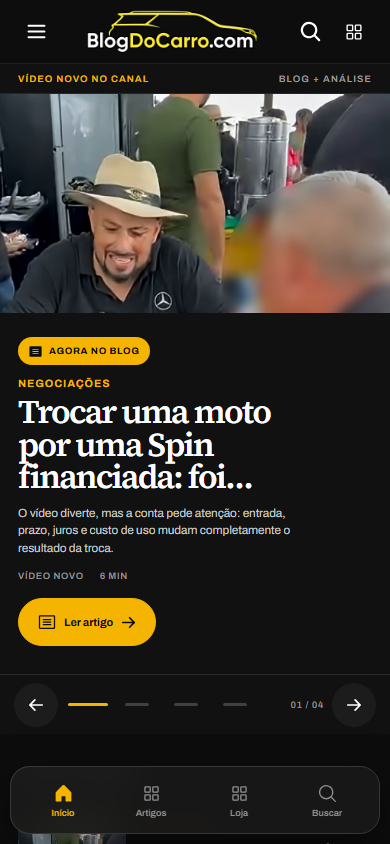
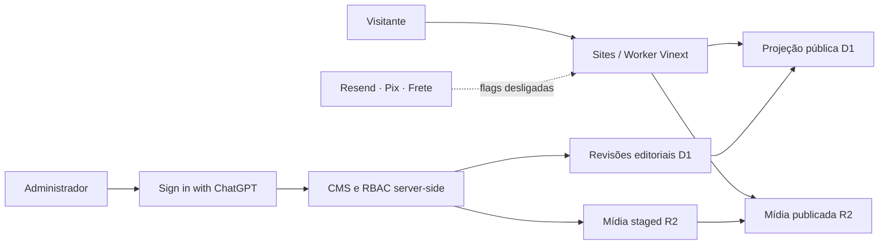

<div align="center">
  
  <h1>Blog do Carro</h1>
  <p><strong>Portal automotivo mobile-first para transformar negociações reais em conteúdo útil, confiável e direto.</strong></p>
  <p>
    <a href="https://blog-do-carro.edubertin.chatgpt.site/"><strong>Abrir demonstração</strong></a>
    · <a href="docs/IMPLEMENTATION_PLAN.md">Arquitetura</a>
    · <a href="SECURITY.md">Segurança</a>
  </p>
  <p>
    
    <a href="https://github.com/Edubertin/blog-do-carro/actions/workflows/ci.yml"></a>
    
    
  </p>
</div>

> [!NOTE]
> O desenvolvimento foi pausado em agosto de 2026. O site permanece disponível como demonstração pública do produto e da arquitetura construída. Loja, checkout, pagamentos, frete, mailing e contas de clientes não estão em operação.



## O produto

O Blog do Carro nasceu para transformar os vídeos e as negociações do canal **Deu Negócio** em uma experiência editorial própria. A proposta combina autoridade de conteúdo, navegação confortável no celular e uma arquitetura preparada para evoluir de portal para comunidade, loja e marketplace.

A identidade usa preto, amarelo e branco, com linguagem visual automotiva, cards editoriais, movimento discreto e foco em leitura rápida. O projeto foi pensado primeiro para smartphones, que representam 87% do público esperado.

## O que foi construído

| Área | Entrega |
| --- | --- |
| Portal editorial | Home responsiva, hero em carrossel, categorias, busca, artigos relacionados, FAQ e SEO estruturado |
| CMS próprio | Criação, revisão, publicação, arquivamento e restauração de versões |
| Editor contínuo | Texto, subtítulos e imagens inseridas no cursor, com conteúdo JSON validado |
| Mídia | Upload protegido, ciclo `staged → published`, entrega por R2 e validação de imagens |
| Administração | SIWC, RBAC server-side, artigos, home, menu, produtos, audiência, integrações e segurança |
| Loja da comunidade | Catálogo e carrinho demonstrativos; chaveiro e miniatura preservados como conceito |
| Audiência | Fundação fail-closed para newsletter e interesse na loja, double opt-in e templates Resend |
| Qualidade | TypeScript estrito, testes de domínio, D1, Worker, Playwright e acessibilidade |

<table>
  <tr>
    <td width="50%"></td>
    <td width="50%"></td>
  </tr>
</table>

## Estado das capacidades

### Disponível na demonstração

- leitura pública dos artigos publicados;
- carrossel editorial alimentado pelas capas dos artigos;
- CMS protegido para os administradores configurados no Sites;
- editor estruturado e histórico de revisões;
- armazenamento e entrega de mídia pelo runtime do Sites;
- catálogo visual da Loja da Comunidade;
- layout dos e-mails de confirmação e acesso em preview administrativo.

### Preparado, mas desligado

- captura pública de e-mails e envio pelo Resend;
- acesso de clientes por magic link;
- persistência de pedidos;
- Mercado Pago exclusivamente por Pix;
- Meu Envio, rastreio, favoritos, comparador e marketplace;
- automação de ingestão dos vídeos do YouTube.

## Arquitetura



Princípios importantes:

- o conteúdo público lê somente uma projeção publicada;
- rascunhos e revisões nunca vazam para as rotas públicas;
- bindings não ativam capacidades automaticamente;
- mídia staged permanece privada;
- admin, cliente, pagamentos e frete são domínios separados;
- secrets ficam exclusivamente no mecanismo server-side do Sites.

As decisões técnicas estão registradas em [`docs/adr`](docs/adr) e o desenho completo em [`docs/IMPLEMENTATION_PLAN.md`](docs/IMPLEMENTATION_PLAN.md).

## Stack

- React 19 e TypeScript estrito;
- App Router compatível por Vinext;
- Vite e Cloudflare Worker;
- Sites como plataforma exclusiva de publicação;
- D1 para conteúdo e revisões;
- R2 para mídia própria;
- Playwright e Axe para fluxos e acessibilidade;
- Resend preparado atrás de um `EmailProvider`, ainda desativado.

## Executar localmente

Requisitos: Node.js 22.13 ou superior e npm.

```bash
git clone https://github.com/Edubertin/blog-do-carro.git
cd blog-do-carro
npm ci
npm run dev
```

Abra a URL local exibida pelo Vinext. Em loopback, o painel `/admin` usa uma identidade sintética de preview e não deve receber dados reais.

## Verificação

```bash
npm run ci
npm run test:e2e
```

O CI executa lint, typecheck, build do Worker, testes unitários, integração D1/R2, auditoria das dependências de produção e testes mobile/desktop com acessibilidade.

## Segurança e privacidade

O repositório não contém chaves, tokens, bancos de produção ou dados pessoais. As integrações permanecem fail-closed quando suas configurações server-side não existem.

Relate vulnerabilidades de forma privada conforme [`SECURITY.md`](SECURITY.md). Não publique credenciais, e-mails reais, payloads de pagamento ou dados de clientes em issues.

## Documentação

- [`PROJECT.md`](PROJECT.md) — mapa rápido e decisões vigentes;
- [`docs/IMPLEMENTATION_PLAN.md`](docs/IMPLEMENTATION_PLAN.md) — arquitetura e fases;
- [`docs/COMMERCE_MOCK_SPEC.md`](docs/COMMERCE_MOCK_SPEC.md) — limites da loja demonstrativa;
- [`docs/specs`](docs/specs) — contratos funcionais e técnicos;
- [`docs/adr`](docs/adr) — decisões arquiteturais;
- [`docs/qa`](docs/qa) — auditorias e evidências;
- [`PROJECT_STATUS.md`](PROJECT_STATUS.md) — estado de encerramento provisório.

## Contribuição e uso

O projeto está pausado e não mantém um roadmap ativo. Consulte [`CONTRIBUTING.md`](CONTRIBUTING.md) antes de abrir uma contribuição.

Este repositório é público para fins de portfólio, estudo arquitetural e preservação do trabalho. **Nenhuma licença permissiva é concedida.** Marca, identidade visual, conteúdo e assets permanecem protegidos por seus respectivos direitos. Consulte [`NOTICE.md`](NOTICE.md).

---

<div align="center">
  <strong>Blog do Carro</strong><br>
  Informação direta para comprar, vender e negociar melhor.
</div>
