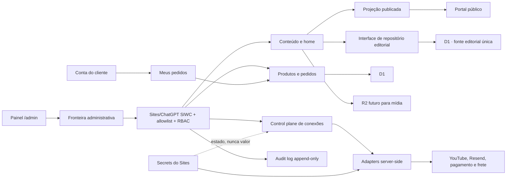

# Spec — Central administrativa e control plane

## 1. Objetivo

Definir o painel administrativo do Blog do Carro como uma superfície única para conteúdo, home, menu, loja, pedidos, analytics, conexões e segurança, preservando três fronteiras:

1. o mock visual não persiste nem executa ações externas;
2. a implementação real autoriza toda ação no servidor;
3. valores de credenciais nunca entram no painel, no D1, no HTML ou no bundle do navegador.

## 2. Resultado para a pessoa administradora

Uma pessoa sem conhecimento técnico deve conseguir entender:

- o que está publicado, em revisão ou aguardando decisão;
- como um vídeo do YouTube vira artigo e destaque da home;
- quais produtos e pedidos exigem atenção;
- quais conexões estão ausentes, em sandbox, saudáveis ou ativas;
- por que determinada capacidade ainda não pode ser ligada;
- quais ações foram realizadas e por quem.

O painel deve parecer uma central operacional do Blog do Carro, não um tema de dashboard genérico.

## 3. Escopo do mock atual

- rotas administrativas completas e responsivas;
- dados sintéticos e identificadores `DEMO-*`;
- formulários editáveis somente em memória React;
- ordenação local da home;
- ativação local de itens de menu;
- criação e arquivamento local de produtos fictícios;
- seleção e preflight simulado de conectores;
- visualização de papéis e audit log fictícios;
- fronteira de autorização server-side com SIWC, owner e negação por padrão;
- `noindex`, `nofollow`, `private, no-store` e bloqueio de frame;
- identidade sintética somente por HTTP em loopback; host publicado exige SIWC e owner configurado.

## 4. Fora do escopo do mock

- OAuth, cookie administrativo paralelo ou cadastro de administrador mantido pela aplicação;
- D1, R2, upload, CMS ou persistência;
- segredo, token, senha, chave de API ou credencial;
- chamada para YouTube, Resend, Mercado Livre, Mercado Pago ou Meu Envio;
- cobrança, webhook, etiqueta, rastreio ou pedido real;
- analytics ou dados de visitante reais;
- alteração do conteúdo público.

## 5. Mapa de rotas

| Rota | Missão principal | Fonte no mock |
| --- | --- | --- |
| `/admin` | resumo operacional e próximos gates | fixtures tipadas |
| `/admin/analytics` | leitura de aquisição, conteúdo, dispositivo e loja | números ilustrativos |
| `/admin/artigos` | fila editorial e estados | fixtures editoriais separadas |
| `/admin/artigos/novo` | criar artigo completo a partir de vídeo | estado da página |
| `/admin/home` | ordenar seções e revisar o hero | estado React |
| `/admin/menu` | exibir ou ocultar itens | estado React |
| `/admin/loja/produtos` | adicionar e arquivar itens | estado React |
| `/admin/loja/configuracoes` | identidade e regras públicas da loja | formulário sem persistência |
| `/admin/pedidos` | fila e detalhe sintético | fixtures `DEMO-*` |
| `/admin/integracoes` | requisitos, estados, rotas e gates dos conectores | contratos tipados |
| `/admin/seguranca` | papéis, fronteira e auditoria | fixtures de segurança |

### 5.1 Arquitetura-alvo



O mock atual representa a superfície visual e a primeira fronteira de `Boundary` e `Auth`. Bancos, storage, audit log persistente, adapters e serviços externos permanecem ausentes e inativos. A confiança nos headers de identidade ainda precisa ser comprovada em um preview real do Sites antes de publicar ou ativar dados.

## 6. Princípios de experiência

- mobile-first para 360–430 px e navegação confortável com uma mão;
- uma ação principal por contexto;
- informação operacional antes de decoração;
- estado sempre expresso por texto e forma, nunca somente cor;
- ações críticas futuras recebem revisão, confirmação, reautenticação e rollback;
- páginas densas usam listas, filas e timelines antes de tabelas;
- desktop expande a mesma arquitetura em uma barra lateral persistente;
- motion discreto e compatível com `prefers-reduced-motion`.

## 7. Modelo de artigo futuro

O editor real exige:

- `title`, `subtitle`, `slug`, `seoDescription`;
- imagem principal, dimensões, origem e texto alternativo;
- categoria, autor, data, tempo de leitura e relacionados;
- blocos estruturados do artigo;
- bloco `Minha opinião`;
- `youtubeVideoId` e metadados de origem;
- FAQ estruturado;
- estado `draft | review | scheduled | published | archived`;
- data de agendamento e revisão atual;
- histórico de versões e audit events.

Regra estrutural: o domínio editorial acessa D1 por uma interface de repositório server-side. Rotas públicas consomem uma projeção somente de artigos publicados e nunca importam a coleção administrativa crua.

## 8. Fluxo vídeo → artigo → home

1. O conector detecta um vídeo novo e cria um rascunho idempotente pelo ID do YouTube.
2. O editor confirma origem, frame, recorte mobile e texto alternativo.
3. Preenche título editorial, pergunta, subtítulo, corpo, opinião, FAQ e SEO.
4. Salva rascunho ou envia para revisão.
5. Um publicador revisa as diferenças e agenda ou publica.
6. A publicação gera audit event e revalida a projeção pública.
7. A home recebe o item de acordo com a curadoria; upload não publica sozinho.

## 9. Fluxo de produto e pedido

1. A operação cria ou edita um produto sem ativar venda.
2. Produto exige SKU, preço em centavos, imagens, estoque, políticas e estado.
3. Ativação comercial depende de pagamento, frete, privacidade e suporte homologados.
4. Pedido real nasce no servidor com snapshots imutáveis de preço e item.
5. Pagamento, atendimento e envio usam estados separados.
6. Mudança de estado válida gera evento append-only.
7. Cliente vê somente a projeção segura definida em `customer-order-portal.md`.

## 10. Estados de conector

O painel real não usa um único rótulo ambíguo. Mantém quatro dimensões:

| Dimensão | Valores iniciais |
| --- | --- |
| modo permitido | `disabled | sandbox | live` |
| configuração | `missing | configured | invalid` |
| saúde | `unknown | healthy | degraded | failing` |
| ativação | `inactive | pending_approval | active | suspended` |

A capacidade efetiva exige, ao mesmo tempo:

```text
código presente
AND ambiente permitido
AND configuração válida
AND adapter saudável
AND flag server-side ativa
AND usuário autorizado
```

O navegador nunca determina se uma capacidade está ativa.

## 11. Gestão de secrets

### O painel pode mostrar

- nome lógico, como `RESEND_API_KEY`;
- ambiente;
- `configurado` ou `não configurado`;
- data da última rotação;
- fingerprint não reversível quando o provedor permitir;
- resultado sanitizado do último health check.

### O painel nunca mostra ou recebe

- valor atual ou anterior;
- senha, token, cookie, chave privada ou payload de webhook;
- campo que sugira colar secret no primeiro control plane;
- botão capaz de devolver credencial ao navegador.

Inserção e rotação pertencem ao mecanismo de secrets do Sites. D1 guarda somente metadados operacionais e referência lógica.

## 12. Autenticação administrativa

- identidade administrativa gerenciada por Sites/ChatGPT SIWC, sem senha própria no D1;
- proteção de `/admin/*` e `/api/admin/*` antes do handler público;
- leitura server-side de `oai-authenticated-user-id` como identificador estável;
- e-mail aceito somente com `ADMIN_EMAIL_BOOTSTRAP_ENABLED=1`, para bootstrap controlado, e nunca como autorização no navegador;
- sessão SIWC gerenciada pelo Sites, sem cookie administrativo paralelo nesta fase;
- negação por padrão;
- primeiro owner provisionado exclusivamente no servidor, fora do código e do Git;
- remover usuário ou papel revoga o acesso na requisição seguinte;
- cada API, Server Action e repositório repete a autorização necessária.
- mutações administrativas exigem `Origin` de mesma origem na fronteira do Worker;
- o bootstrap por e-mail é desligado depois que os IDs estáveis dos owners forem capturados;
- um preview publicado deve provar proteção contra headers de identidade forjados e acesso direto ao Worker antes da ativação de dados reais.

A identidade do cliente nunca concede acesso ao admin e a identidade do admin nunca substitui a sessão do cliente.

## 13. RBAC inicial

Permissões são verificadas no servidor:

- `content.read | write | review | publish`;
- `home.read | write | publish`;
- `catalog.read | write | activate`;
- `orders.read | update`;
- `customer_pii.read`;
- `analytics.read`;
- `connectors.read | test | activate`;
- `flags.read | change`;
- `admin_users.manage`;
- `audit.read`.

Papéis de partida: `owner`, `editor`, `publisher`, `commerce_operator`, `support`, `analyst` e `integrations_admin`.

## 14. Audit log

Eventos administrativos registram:

- ID, timestamp, request ID e sessão;
- ator e permissão usada;
- ação, recurso e ambiente;
- resultado `allowed | denied | failed`;
- estado anterior e posterior sanitizados;
- motivo obrigatório para ações sensíveis.

O log é append-only para a aplicação. Nunca registra secret, token, cookie, payload integral, endereço ou e-mail completo. Revelação excepcional de PII também gera evento.

## 15. Analytics

Eventos permitidos:

- visualização de página e artigo;
- início do vídeo;
- busca;
- produto visto;
- início do checkout;
- newsletter após consentimento.

Regras:

- sem IP persistido;
- sem parâmetro de autenticação, pedido ou token;
- agregação diária separada do tráfego público;
- dados administrativos e de clientes não entram nos eventos de conteúdo;
- números do mock são sempre rotulados como ilustrativos.

## 16. Dados futuros

Domínios separados:

- editorial: artigos, revisões, autores, categorias, FAQs, menus e home;
- administração: usuários, papéis, sessões, flags e auditoria;
- loja: produtos, variantes, estoque e configurações;
- comércio: clientes, pedidos, itens, pagamentos, envios e webhooks;
- analytics: eventos com retenção curta e agregados diários.

O ADR 0001 define o CMS interno com D1 como fonte editorial única, isolada por interface de repositório e por uma projeção publicada. R2 será usado futuramente para mídia própria. O mock não ativa D1, R2, uploads ou CRUD real.

## 17. Segurança do mock

- HTTP em loopback recebe identidade sintética apenas para desenvolvimento;
- host publicado sem configuração falha fechado; identidade ausente, desconhecida ou sem permissão não acessa o admin;
- mutações administrativas exigem `Origin` de mesma origem;
- resposta administrativa usa `private, no-store`;
- `X-Frame-Options: DENY` e `Referrer-Policy: no-referrer`;
- metadata `noindex,nofollow` e `Disallow: /admin/`;
- nenhuma gravação em `localStorage` ou `sessionStorage`;
- nenhuma chamada para host externo;
- nenhuma credencial no formulário;
- recarregar restaura todas as fixtures.

Esses controles limitam o mock; não substituem o teste do dispatcher em preview real nem autorizam persistência, conectores ou dados reais.

## 18. Critérios de aceite do mock

- todas as rotas da matriz respondem em host local;
- navegação pública não aparece dentro do admin;
- desktop e mobile compartilham os mesmos destinos;
- aviso de demonstração aparece em todas as telas;
- editar, ordenar, ativar ou arquivar muda apenas estado React;
- integrações nunca solicitam valor secreto;
- pedidos usam apenas `DEMO-*` e não leem dados do checkout;
- ações informam claramente o efeito simulado;
- admin não aparece no sitemap e é desautorizado no robots;
- host publicado sem owner configurado falha fechado e mutação cross-origin é recusada;
- reload restaura o estado original;
- lint, TypeScript, build, testes de renderização e QA de navegador passam.

## 19. Critérios de aceite da versão real

- toda rota HTML e API administrativa é protegida no servidor;
- testes negativos provam `deny by default` por permissão;
- cliente e admin não compartilham cookie, tabela de sessão ou autorização;
- nenhum secret aparece em HTML, JSON, D1, bundle, erro ou log;
- preview e produção usam contas, bindings, dados e secrets separados;
- ativação live falha com secret ausente, health falho ou sessão antiga;
- publicação, mudança de papel, flag, conector e pedido geram audit event;
- operações críticas são idempotentes;
- rollback desativa superfícies sem apagar evidências;
- política de privacidade, retenção e suporte está aprovada.

## 20. Sequência recomendada

1. validar o mock com responsáveis por editorial, operação e marca;
2. detalhar os contratos de repositório, schema e migrations do CMS interno;
3. implementar Sites/ChatGPT SIWC, proteção server-side, bootstrap de owner e RBAC com todas as capacidades desligadas;
4. criar D1, migrations e audit log em preview apenas para os domínios aprovados;
5. implementar o CRUD no D1 pela interface de repositório e manter a projeção pública;
6. ativar uploads R2 com política e validação;
7. implementar analytics first-party agregado;
8. homologar conectores um por vez;
9. ativar comércio somente após produto, políticas e operação reais.
